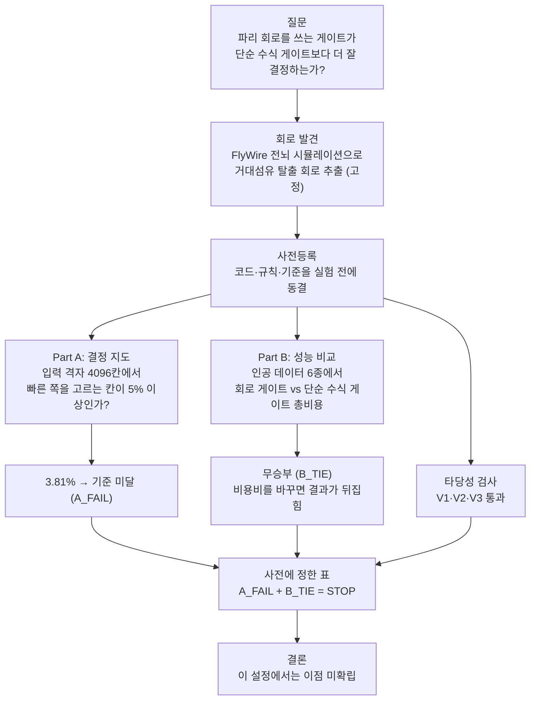

# reflex-router

## 목표

신경망을 모사한 회로를 거쳐 요청을 소형 모델(fast-track)과 대형 모델(Quality-track) 중 어디로 보낼지 결정함.

## 결과

**파리 신경 회로를 쓰는 방식이 기존의 단순한 방식보다 낫다는 증거를 얻지 못함.**



### 무엇을 비교했나

요청이 오면 "빠르게 대충 답할지, 시간을 들여 정확히 답할지"를 정해야 합니다. 두 가지 방식으로 이 결정을 내려 보고 비교했습니다.

- **회로 게이트**: 파리가 위험을 느꼈을 때 즉시 도망갈지 신중하게 움직일지 정하는 신경 회로를 컴퓨터로 흉내 내어 결정합니다.
- **단순 수식 게이트**: 요청의 특징(길이, 위험도 등)에 점수를 매겨 더한 뒤, 기준점을 넘으면 한쪽, 못 넘으면 다른 쪽으로 보냅니다. 비교용으로 가장 단순하게 만든 기준입니다.

단순 수식 게이트의 계산은 이렇습니다.

```
점수 = w1·s + w2·L + w3·k + w4·b
점수 > t  →  빠른 답을 그대로 사용
점수 ≤ t  →  신중한 쪽으로 넘김
```

- 입력 4개: s(캐시 유사도), L(요청 길이), k(위험 등급), b(지연 예산)
- w1~w4(가중치): 프로젝트가 직접 만든 인공 데이터 2000건으로 로지스틱 회귀를 돌려 구합니다. 외부 모델은 쓰지 않았고, 시나리오와 시드마다 새로 학습합니다.
- t(기준점): 같은 학습 데이터에서 총비용이 가장 낮아지는 값을 고릅니다.
- 비용: 빠른 답이 맞으면 1, 틀리면 1+P, 신중한 쪽으로 넘기면 5. P는 틀렸을 때의 손해 크기로 3, 10, 30을 시험했습니다.

### 두 가지 시험

**Part A. 회로가 입력에 따라 제대로 갈라지는가**
입력 값을 격자(4096칸)로 훑으며 회로가 "빠른 쪽"과 "신중한 쪽" 중 어느 쪽을 고르는지 지도를 그렸습니다. 한쪽이 거의 전부이면 입력에 반응하는 게이트가 아닙니다. 그래서 빠른 쪽을 고르는 칸이 전체의 5% 이상이어야 통과라는 기준을 미리 정했습니다.
→ 실제로는 3.81%(156칸)여서 **기준에 못 미쳤습니다.** (5%는 근거 있는 값이 아니라 설계 때 정한 값입니다.)

**Part B. 실제로 더 잘 결정하는가**
실제 요청이 아니라 프로젝트가 직접 만든 인공 데이터 여섯 종류(선형, 비선형, 신호와 무관한 경우 등)에서 두 게이트가 결정을 내리게 하고, 틀렸을 때의 손해까지 합친 총비용을 비교했습니다. 학습 2000건으로 맞춘 뒤, 학습에 쓰지 않은 20000건으로 평가했고 이를 시드 20개로 반복했습니다.
→ **무승부**였습니다. 한 시나리오에서는 회로가 3% 앞섰지만, 틀렸을 때의 손해를 더 크게 잡자 결과가 뒤집혀서 앞섰다고 말할 수 없습니다. 비교용 신경망(MLP)에는 크게 졌습니다.

### 결론과 한계

- 사전에 정한 표에 따라 **"이 설정에서는 이점 없음(STOP)"** 입니다.
- 회로 방식이 틀렸다는 뜻은 아닙니다. 이 조건과 이 단순한 기준에서 이점을 찾지 못했다는 뜻입니다.
- 파리의 위험 반응을 요청 라우팅에 대응시킨 것은 유추이며, 생물학적으로 입증된 것이 아닙니다.
- 인공 데이터에서의 비교이므로 실제 LLM 요청에서의 성능을 말해 주지 않습니다.
- 판정이 5% 기준과 격자 범위에 민감합니다.

자세한 내용: [docs/report.md](docs/report.md) · [한국어](docs/report.ko.md)


## Reference

- von Reyn et al. (2014). A spike-timing mechanism for action selection. Nature Neuroscience.
- Chen, Zaharia, Zou (2023). FrugalGPT. TMLR 2024.
- Dean, Barroso (2013). The Tail at Scale. CACM.
- Dorkenwald et al. (2024). Neuronal wiring diagram of an adult brain. Nature.

## License

- 커넥톰 회로 데이터: CC BY-NC 4.0 (FlyWire)

## Changelog

- [CHANGELOG.md](CHANGELOG.md)
